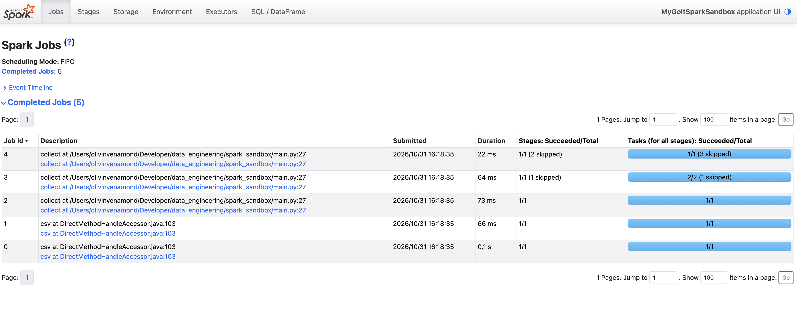
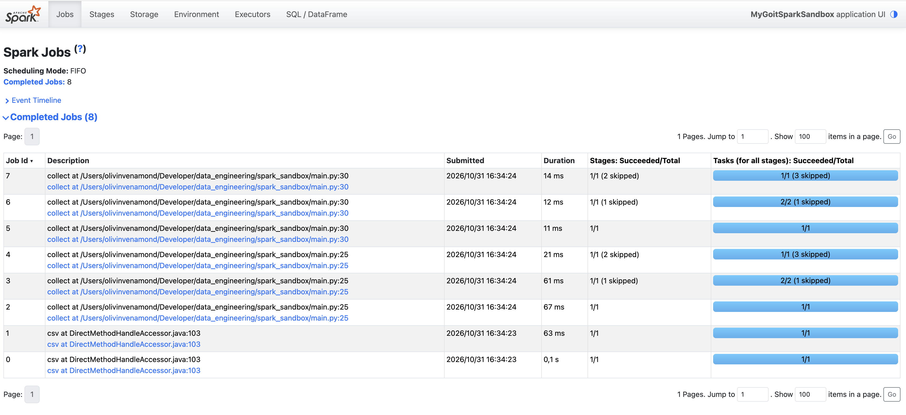
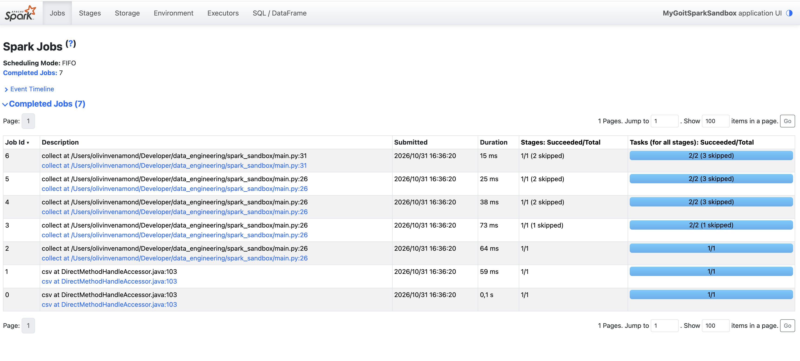

# goit-de-hw-04

Скриншоти зі сторінки Spark UI.

Спільне для всіх трьох запусків: **Job 0 і Job 1** (`csv at ...`) створює читання CSV з `inferSchema=true`. Spark спочатку читає заголовок, потім проходить увесь файл, щоб визначити типи колонок.

## Частина 1 — 5 Jobs

5 = 2 (читання CSV) + 3 (`collect()`).

У ланцюжку два shuffle: `repartition(2)` і `groupBy`. Spark (AQE) виконує запит частинами між shuffle, і кожна частина — окремий Job:
- Job 2 — читання файлу і розподіл на 2 партиції;
- Job 3 — `where`, `select`, частковий підрахунок за `unit_id`;
- Job 4 — фінальний підрахунок, `count>2`, повернення результату.

## Частина 2 — 8 Jobs

8 = 2 (читання CSV) + 3 (перший `collect()`) + 3 (другий `collect()`).

Кожен action запускає весь ланцюжок заново. Spark не зберігає результат першого `collect()`, тому другий `collect()` знову проходить `repartition` → `groupBy` → `where` і створює ще 3 Jobs.

Перший `collect()`:
- Job 2 — читання файлу і розподіл на 2 партиції;
- Job 3 — `where`, `select`, частковий підрахунок за `unit_id`;
- Job 4 — фінальний підрахунок, повернення результату.

Другий `collect()` (після `where("count>2")`):
- Job 5 — знову читання файлу і розподіл на 2 партиції;
- Job 6 — знову `where`, `select`, частковий підрахунок за `unit_id`;
- Job 7 — фінальний підрахунок, `count>2`, повернення результату.

Позначка `skipped` означає, що stage вже виконано в попередньому Job, і Spark бере його готовий результат.

## Частина 3 — 7 Jobs

7 = 2 (читання CSV) + 3 (перший `collect()`) + 2 (другий `collect()`).

Перший `collect()` рахує все як звичайно і зберігає результат `groupBy` у пам'яті (`cache()`):
- Job 2 — читання файлу і розподіл на 2 партиції;
- Job 3 — `where`, `select`, частковий підрахунок за `unit_id`;
- Job 4 — фінальний підрахунок, запис результату в кеш, повернення результату.

Другий `collect()` бере дані з кешу і не перераховує `repartition` та `groupBy`:
- Job 5 — читання закешованих даних;
- Job 6 — `where("count>2")` і повернення результату.

`cache()` зберігає проміжний результат у пам'яті після першого action. Наступні дії над цим DataFrame беруть готові дані, а не рахують весь ланцюжок від читання файлу. Це корисно, коли один і той самий результат використовується кілька разів. `unpersist()` звільняє пам'ять, коли кеш більше не потрібен.
